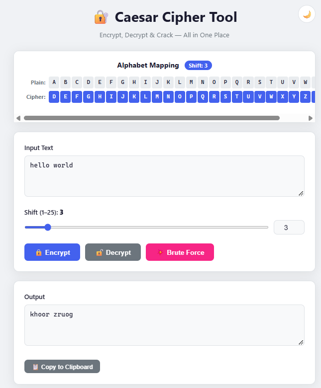
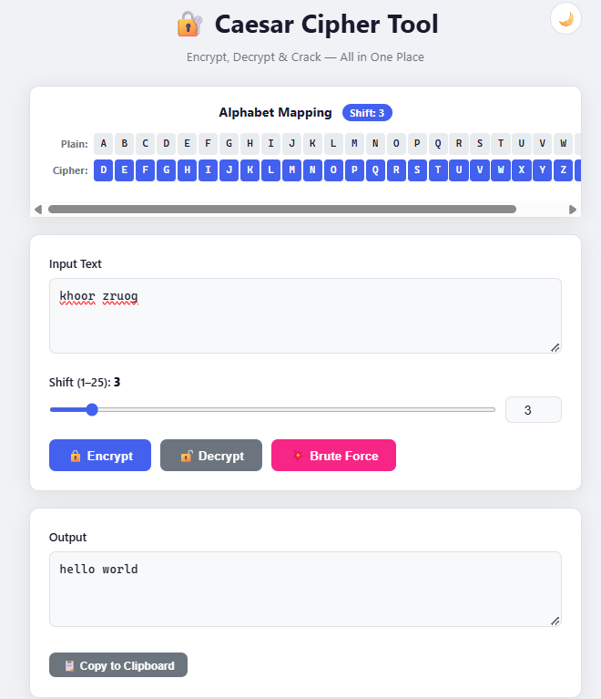
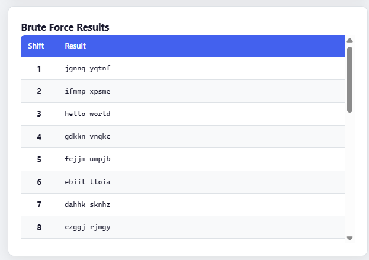

# 🔐 Caesar Cipher Tool

A full-stack web application to **encrypt**, **decrypt**, and **brute-force crack** messages using the classic [Caesar Cipher](https://en.wikipedia.org/wiki/Caesar_cipher) algorithm. Built with **Spring Boot** on the backend and **Vanilla JavaScript** on the frontend.

---

## 📑 Table of Contents

- [Features](#-features)
- [Screenshots](#-screenshots)
- [How the Caesar Cipher Works](#-how-the-caesar-cipher-works)
- [Tech Stack](#-tech-stack)
- [Prerequisites](#-prerequisites)
- [Getting Started](#-getting-started)
- [API Reference](#-api-reference)
- [Project Structure](#-project-structure)
- [Architecture](#-architecture)
- [Running Tests](#-running-tests)
- [Contributing](#-contributing)
- [License](#-license)

---

## ✨ Features

| Feature | Description |
|---------|-------------|
| **Encrypt** | Shift every letter forward by a chosen amount (1–25) |
| **Decrypt** | Reverse the shift to recover the original message |
| **Brute Force** | Try all 25 possible shifts at once to crack an unknown cipher |
| **Alphabet Mapping** | Live visualization showing the plain → cipher letter mapping |
| **Shift Controls** | Synced range slider + number input for quick adjustment |
| **Copy to Clipboard** | One-click copy of the output text |
| **Dark Mode** | Toggle between light and dark themes (preference saved in `localStorage`) |
| **Input Validation** | Server-side validation with clean JSON error messages |
| **Responsive Design** | Works on desktop, tablet, and mobile screens |

---

## 📸 Screenshots

### Encryption

Encrypting `hello world` with a shift of **3** produces `khoor zruog`:



### Decryption

Decrypting `khoor zruog` with a shift of **3** recovers the original `hello world`:



### Brute Force

Don't know the shift? Brute force tries all 25 possibilities — the correct plaintext jumps out at shift **3**:



---

## 🧮 How the Caesar Cipher Works

The Caesar Cipher is one of the simplest and oldest encryption techniques. Each letter in the plaintext is replaced by a letter a fixed number of positions down the alphabet.

**Encryption formula:**

```
E(x) = (x + k) mod 26
```

**Decryption formula:**

```
D(x) = (x − k) mod 26
```

Where:
- `x` = zero-based index of the letter (A=0, B=1, … Z=25)
- `k` = the shift key (1–25)

**Example with shift = 3:**

| Plain  | A | B | C | D | E | F | G | H | I | J | K | L | M | N | O | P | Q | R | S | T | U | V | W | X | Y | Z |
|--------|---|---|---|---|---|---|---|---|---|---|---|---|---|---|---|---|---|---|---|---|---|---|---|---|---|---|
| Cipher | D | E | F | G | H | I | J | K | L | M | N | O | P | Q | R | S | T | U | V | W | X | Y | Z | A | B | C |

**Rules:**
- Uppercase letters stay uppercase, lowercase stay lowercase
- Digits, spaces, punctuation, and special characters pass through unchanged
- Wraparound: `Z` with shift 1 → `A`

Since there are only 26 possible keys, the cipher can be **brute-forced** by trying all 25 non-trivial shifts.

---

## 🛠 Tech Stack

| Layer | Technology |
|-------|-----------|
| **Language** | Java 17 |
| **Backend** | Spring Boot 3.2.5 |
| **Web Server** | Embedded Apache Tomcat |
| **Validation** | Jakarta Bean Validation (`@NotBlank`, `@Min`, `@Max`) |
| **Build Tool** | Apache Maven |
| **Frontend** | HTML5, CSS3, Vanilla JavaScript |
| **Testing** | JUnit 5 |

---

## 📋 Prerequisites

- **Java 17** or higher ([Download](https://adoptium.net/))
- **Apache Maven 3.8+** ([Download](https://maven.apache.org/download.cgi))

Verify your installation:

```bash
java -version
mvn -version
```

---

## 🚀 Getting Started

### 1. Clone the repository

```bash
git clone https://github.com/<your-username>/Caesar-Cipher.git
cd Caesar-Cipher/caesar-app
```

### 2. Build and run

```bash
mvn spring-boot:run
```

Or build the JAR and run it directly:

```bash
mvn clean package
java -jar target/caesar-app-1.0.0.jar
```

### 3. Open in your browser

Navigate to **[http://localhost:8080](http://localhost:8080)** — you'll see the Caesar Cipher Tool UI ready to use.

---

## 📡 API Reference

The backend exposes a REST API under `/api`. All endpoints accept `POST` requests with a JSON body.

### `POST /api/encrypt`

Encrypts plaintext with the given shift.

**Request:**

```json
{
  "text": "hello world",
  "shift": 3
}
```

**Response** `200 OK`:

```json
{
  "result": "khoor zruog"
}
```

---

### `POST /api/decrypt`

Decrypts ciphertext with the given shift.

**Request:**

```json
{
  "text": "khoor zruog",
  "shift": 3
}
```

**Response** `200 OK`:

```json
{
  "result": "hello world"
}
```

---

### `POST /api/bruteforce`

Tries all 25 possible shifts on the ciphertext.

**Request:**

```json
{
  "text": "KHOOR"
}
```

**Response** `200 OK`:

```json
[
  { "shift": 1,  "result": "JGNNQ" },
  { "shift": 2,  "result": "IFMMP" },
  { "shift": 3,  "result": "HELLO" },
  ...
  { "shift": 25, "result": "LIPPS" }
]
```

---

### Error Handling

Invalid input returns **HTTP 400** with a descriptive error:

```json
{
  "error": "text: Text must not be blank"
}
```

| Validation Rule | Constraint |
|----------------|-----------|
| `text` | Must not be blank |
| `shift` | Must be between 1 and 25 (encrypt/decrypt only) |

---

## 📁 Project Structure

```
Caesar-Cipher/
├── README.md
├── screenshots/
│   ├── encrypt.png
│   ├── decrypt.png
│   └── brute-force.png
└── caesar-app/
    ├── pom.xml
    └── src/
        ├── main/
        │   ├── java/com/dsp/caesar/
        │   │   ├── CaesarApplication.java       # Spring Boot entry point
        │   │   ├── CaesarController.java         # REST controller (/api/*)
        │   │   ├── CaesarService.java            # Cipher algorithm logic
        │   │   ├── CipherRequest.java            # Request DTO (encrypt/decrypt)
        │   │   ├── BruteForceRequest.java        # Request DTO (brute force)
        │   │   ├── BruteForceResult.java         # Response DTO (brute force row)
        │   │   └── GlobalExceptionHandler.java   # Validation error handler
        │   └── resources/static/
        │       ├── index.html                    # Single-page UI
        │       ├── style.css                     # Light/dark theme styles
        │       └── script.js                     # Frontend logic & API calls
        └── test/java/com/dsp/caesar/
            └── CaesarServiceTest.java            # Unit tests (13 test cases)
```

---

## 🏗 Architecture

```
┌──────────────────────────────────────┐
│            Browser (Client)          │
│  ┌──────────┬──────────┬──────────┐  │
│  │index.html│style.css │script.js │  │
│  └──────────┴──────────┴────┬─────┘  │
└─────────────────────────────┼────────┘
                              │ fetch() — POST /api/*
                              ▼
┌──────────────────────────────────────┐
│       Spring Boot :8080 (Tomcat)     │
│                                      │
│  /static/*  ──→ serves frontend      │
│                                      │
│  /api/encrypt ──┐                    │
│  /api/decrypt ──┼→ CaesarController  │
│  /api/bruteforce┘        │           │
│                          ▼           │
│                   CaesarService      │
│                  (cipher logic)      │
│                                      │
│  GlobalExceptionHandler              │
│  (catches validation errors → 400)   │
└──────────────────────────────────────┘
```

**Request flow:**

1. User types a message and clicks **Encrypt**, **Decrypt**, or **Brute Force**
2. `script.js` sends a `POST` request with JSON body via `fetch()`
3. Spring Boot's `CaesarController` receives the request, validates it (`@Valid`)
4. `CaesarService` applies the cipher algorithm and returns the result
5. The JSON response is rendered in the Output textarea (or the brute-force table)

---

## 🧪 Running Tests

The project includes **13 unit tests** covering:

| Category | What's tested |
|----------|--------------|
| Basic encryption | `HELLO` + shift 3 → `KHOOR`, lowercase handling |
| Round-trip | Encrypt → decrypt for all 25 shifts on a complex string |
| Wraparound | `Y` + 3 → `B`, `Z` + 1 → `A`, lowercase `z` + 1 → `a` |
| Case preservation | Uppercase stays upper, lowercase stays lower |
| Non-letter characters | Digits, spaces, and punctuation pass through unchanged |
| Negative shift | Internal decrypt mechanism using negative shifts |
| Brute force | Returns exactly 25 results, correct answer at expected shift, shifts numbered 1–25 |

Run the tests:

```bash
cd caesar-app
mvn test
```

Expected output:

```
[INFO] Tests run: 13, Failures: 0, Errors: 0, Skipped: 0
[INFO] BUILD SUCCESS
```

---

## 🤝 Contributing

Contributions are welcome! Here's how:

1. **Fork** this repository
2. Create a feature branch: `git checkout -b feature/my-feature`
3. Commit your changes: `git commit -m "Add my feature"`
4. Push to the branch: `git push origin feature/my-feature`
5. Open a **Pull Request**

---

## 📄 License

This project is open source and available under the [MIT License](LICENSE).
